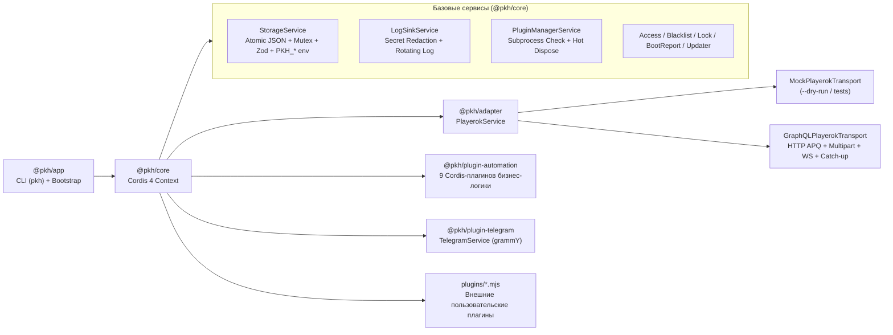

<div align="center">

# ⚡ PlayerOK Harness (`pkh`)

**Модульная платформа автоматизации PlayerOK с архитектурой «всё — плагин»**  
Построена с нуля на **TypeScript**, **Cordis 4**, **grammY** и **Zod**

[](https://github.com/princeofscale/playerokharness/actions/workflows/ci.yml)
[](https://nodejs.org/)
[](https://www.typescriptlang.org/)
[](https://cordis.js.org/)
[](./LICENSE)

[Возможности](#-возможности) · [Архитектура](#-архитектура) · [Быстрый старт](#-быстрый-старт) · [CLI `pkh`](#-команды-cli-pkh) · [Свои плагины](#-разработка-плагинов) · [Безопасность](#-надёжность-и-безопасность)

</div>

---

## ✨ Возможности

### 🧩 Plugin-First на Cordis 4
- **Изолированные сервисы и DI** — каждый компонент объявляет зависимости (`inject`), получает типизированные события (`ctx.on` / `ctx.parallel`) и автоматически очищает ресурсы при выгрузке (`ctx.effect` / `fiber.dispose()`).
- **Горячее управление плагинами** — внешние `.mjs`/`.js` плагины устанавливаются прямо из Telegram, проходят проверку в изолированном дочернем процессе с автоматическим откатом при ошибке и включаются/выключаются без перезапуска ядра.

### 🤖 Полный набор автоматизации
- **🚀 Идемпотентная авто-выдача** — поштучная (с атомарным списанием из `goods`, сериализацией очереди и защитой от двойной выдачи по `deal.id`) и статичным сообщением; привязка по ссылке, UUID, slug или ключевым фразам.
- **♻️ Авто-восстановление и пересоздание** — восстановление проданных и истёкших лотов (`free` / `premium` / `last`), **замена данных товара** (списание строки только после успешной публикации) и **пересоздание черновика** с переносом изображений, автоматической перепривязкой всех настроек и откатом черновика при сбое.
- **⬆️ Авто-поднятие (день / ночь)** — режим по интервалу и режим контроля позиции (поднятие при выпадении ниже порога `streak ≥ 2` + кулдаун + отдельное ночное расписание).
- **☑️ Авто-подтверждение сделок** — с идемпотентностью и гибкими списками `included` / `excluded`.
- **💬 Авто-ответы и команды** — приветствие нового покупателя, настраиваемые шаблоны на события сделок/отзывов/проблем, вызов продавца (`!продавец` / `!seller`) и пользовательские команды.
- **🚫 Чёрный список** — перехват сделок, блокировка автоматизации и опциональный авто-возврат.
- **💸 Авто-вывод средств** — по расписанию на верифицированную карту, СБП или USDT (TRC20).
- **📊 Статистика и кэш заказов** — сводка продаж за 24ч, 7 дней, 30 дней и всё время.

### 📱 Панель управления в Telegram (`grammY`)
- Плавающее меню с пагинацией и фильтрами (чаты, сделки, товары, отзывы, транзакции, правила, ЧС).
- Полное редактирование настроек, интервалов, привязок, поштучных товаров (текст или `.txt`) и реквизитов вывода прямо из Telegram.
- Отправка текста, быстрых ответов и **фотографий** в чаты PlayerOK прямо из Telegram.
- **Setup Mode** — при обрыве или устаревших cookies процесс не падает, а запускает Telegram для починки подключения и авто-перепроверки.
- Поддержка прокси (`HTTP/HTTPS`) и кастомного `apiRoot` (например, Cloudflare Workers).

---

## 🏗️ Архитектура



| Пакет | Описание |
|---|---|
| [`@pkh/core`](./packages/core) | Ядро Cordis 4, типы/энамы, типизированная шина событий, атомарное хранилище с мьютексом и идемпотентностью, маскирование секретов в логах, менеджер плагинов |
| [`@pkh/adapter`](./packages/playerok) | `PlayerokService`, `MockPlayerokTransport` и `GraphQLPlayerokTransport` (HTTP APQ, multipart upload, `graphql-transport-ws`, catch-up, review polling, proxy) |
| [`@pkh/plugin-automation`](./packages/plugin-automation) | 9 независимых плагинов автоматизации с `try/catch`-изоляцией и идемпотентностью |
| [`@pkh/plugin-telegram`](./packages/plugin-telegram) | Полноценный Telegram-интерфейс на `grammY` с пагинацией, фильтрами, FSM, Setup Mode и `addComposer()` |
| [`@pkh/app`](./packages/app) | Точка входа, Setup Mode с авто-перепроверкой и CLI `pkh` |

---

## 🚀 Быстрый старт

Требуется **Node.js ≥ 20** и **pnpm**.

```bash
git clone https://github.com/princeofscale/playerokharness.git
cd playerokharness

pnpm install
pnpm build
pnpm test
```

### Безопасная демонстрация (без реального аккаунта и сети)

```bash
pnpm pkh start --simulate --plugins-dir ./plugins-example
```

Симуляция прогонит полный сквозной сценарий: входящее сообщение → приветствие → `!продавец` → новая сделка → внешний плагин → авто-выдача со списанием остатка → авто-подтверждение → авто-восстановление.

### Первичная настройка и боевой запуск

```bash
# Интерактивный мастер настройки
pnpm pkh setup

# Проверка конфигурации и окружения
pnpm pkh doctor

# Запуск
pnpm pkh start
```

> Секреты можно не хранить в `bot_settings/config.json` — используйте переменные окружения из [`.env.example`](./.env.example) (`PKH_TELEGRAM_TOKEN`, `PKH_PLAYEROK_COOKIES` и др.).

### Установка как системный сервис

- **Linux (systemd + глобальная команда `pkh`)**: `sudo ./scripts/install.sh`
- **macOS**: двойной клик по [`scripts/start_mac.command`](./scripts/start_mac.command)
- **Windows**: [`scripts/start.bat`](./scripts/start.bat)

---

## ⌨️ Команды CLI (`pkh`)

| Команда | Назначение |
|---|---|
| `pkh start` | Запустить PlayerOK Harness |
| `pkh start --dry-run` | Запуск с `MockPlayerokTransport` (можно подключить реальный Telegram) |
| `pkh start --simulate` | Прогнать встроенную сквозную симуляцию и завершиться |
| `pkh setup` | Интерактивная настройка токена Telegram, Cloudflare Worker URL, прокси и cookies |
| `pkh doctor` | Диагностика Node.js, файлов, токенов, cookies и авторизованных владельцев |
| `pkh plugins` | Список установленных внешних плагинов |
| `pkh import-config --from <dir>` | Импорт и Zod-валидация JSON-конфигов из внешнего каталога |

Глобальные флаги: `--data-dir <path>`, `--plugins-dir <path>`, `--no-telegram`, `-h / --help`.

---

## 🔌 Разработка плагинов

Положите `.mjs` файл в каталог `plugins/` или отправьте его прямо в Telegram (**🔌 Плагины → ➕ Установить плагин**). Плагин автоматически получает доступ к типизированным событиям и сервисам Cordis:

```js
export const meta = {
  id: 'hello-plugin',
  name: 'Hello Plugin',
  version: '1.0.0',
  description: 'Отвечает на !ping и логирует новые сделки',
};

export const inject = ['playerok'];

export function apply(ctx) {
  const log = ctx.logger('plugin.hello');

  ctx.on('playerok/new-message', async (event) => {
    if (event.message.text?.trim().toLowerCase() === '!ping') {
      await ctx.playerok.sendMessage(event.chat.id, '🏓 Pong от внешнего плагина pkh!');
    }
  });

  ctx.on('playerok/new-deal', (event) => {
    log.info(`Новая сделка #${event.deal.id} на ${event.deal.item.price}₽`);
  });
}
```

Полный пример — [`plugins-example/hello-plugin.mjs`](./plugins-example/hello-plugin.mjs).  
Для добавления собственных команд и кнопок в Telegram используйте `ctx.telegram.addComposer(composer)`.

---

## 🛡️ Надёжность и безопасность

- **Идемпотентность и мьютексы**: `StorageService.runExclusive()` сериализует конкурентные записи; `idempotency.json` гарантирует, что дублирующиеся события `NEW_DEAL` никогда не спишут товар дважды.
- **Изоляция ошибок**: каждый обработчик событий обёрнут в `try/catch`, а `PlayerokService.dispatchEvent` изолирует падение одного плагина от остальных.
- **Маскирование секретов**: `LogSinkService` автоматически заменяет токены Telegram, cookies, Bearer-токены и пароли на `[REDACTED]` перед выводом в консоль и файл логов.
- **Атомарная запись и бэкапы**: запись конфигов идёт через временный файл + `fsync` + `rename`; повреждённый JSON сохраняется в `.bak` и автоматически восстанавливается по Zod-схеме.
- **Корректная работа с API**: транспорт использует стандартные HTTP/WebSocket-запросы без обхода антибот-защит; при получении challenge-страницы поднимается `BotCheckDetectedError` и активируется Setup Mode.

---

## 🧪 Проверка качества

```bash
pnpm lint       # ESLint + typescript-eslint
pnpm build      # Сборка всех 5 пакетов
pnpm typecheck  # Строгая проверка типов (tsc --noEmit)
pnpm test       # Vitest: unit + integration + local HTTP/WS server
```

---

## 📄 Лицензия

Распространяется под лицензией [MIT](./LICENSE).
